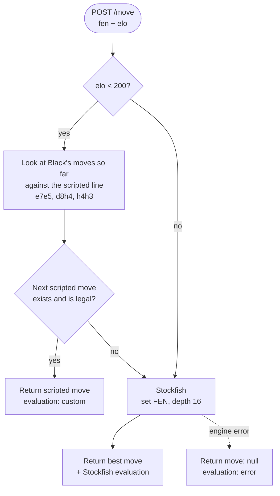
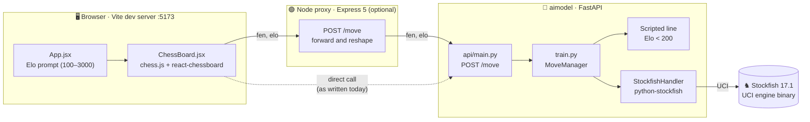
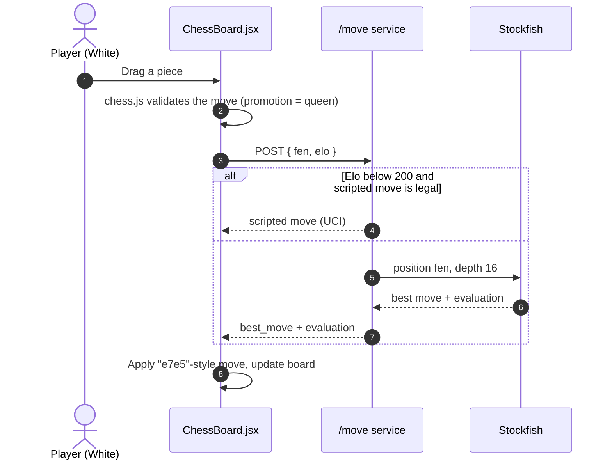

<div align="center">

# ♟️ BlunderZero

<a href="https://github.com/aniruddha9674/blunderzero">
  
</a>

<br/>


<p>
  <a href="#-overview">Overview</a> •
  <a href="#-how-the-bot-picks-a-move">Bot logic</a> •
  <a href="#-architecture">Architecture</a> •
  <a href="#-api-reference">API</a> •
  <a href="#-getting-started">Setup</a> •
  <a href="#-project-status">Status</a>
</p>

</div>

---

## 📖 Overview

**BlunderZero** is a browser chess game against an engine-backed bot. You enter your Elo, play White on a drag-and-drop board, and the bot answers as Black. Each move goes to a Python service that either plays a scripted trap line (for very low Elo) or asks **Stockfish** for its best move and evaluation.

| | |
|---|---|
| 🎮 **Play** | React board with legal-move checking (`chess.js` + `react-chessboard`) |
| 🧠 **Bot** | FastAPI service wrapping Stockfish 17.1 over UCI |
| 🪤 **Traps** | A scripted Black line for Elo below 200, plus ~200 trap games from Lichess studies bundled as PGN data |
| 🔌 **Proxy** | Optional Express 5 server that forwards `/move` to the Python service |

> [!NOTE]
> The repo has two folders: `my-chess-bot/` (React frontend and Node proxy) and `aimodel/` (Python bot service). Both contain a copy of the Stockfish source tree and a Windows binary.

---

## 🧠 How the bot picks a move



> [!IMPORTANT]
> Today the Elo value only decides whether the scripted line is tried. From Elo 200 upwards the bot always plays Stockfish at depth 16, so it does not get weaker for weaker players yet. See the [roadmap](#️-roadmap).

---

## 🏗️ Architecture



### One full turn



---

## 🔌 API reference

### Python service · `POST /move`

**Request**

```json
{
  "fen": "rnbqkbnr/pppppppp/8/8/4P3/8/PPPP1PPP/RNBQKBNR b KQkq - 0 1",
  "elo": 850
}
```

**Response**

```json
{
  "best_move": "e7e5",
  "evaluation": { "type": "cp", "value": 32 }
}
```

| Field | Meaning |
|---|---|
| `best_move` | Move in UCI notation (`e7e5`). `null` if Stockfish failed |
| `evaluation` | Stockfish's `{type, value}` (`cp` = centipawns, `mate` = moves to mate). The scripted line returns `{"type": "custom", ...}` |

Errors come back as HTTP `500` with the exception message in `detail`.

### Node proxy · `POST /move`

Accepts the same body, calls the Python service and returns `{ "move": ..., "evaluation": ... }`. The frontend accepts either `move` or `best_move`.

---

## 📁 Project structure

```text
blunderzero/
├── aimodel/                        # 🐍 Python bot service
│   ├── api/main.py                 # FastAPI app, POST /move
│   ├── train.py                    # StockfishHandler, scripted line, MoveManager
│   ├── utils/
│   │   ├── loadstockfish.py        # standalone Stockfish helpers
│   │   └── loadtraps.py            # loads PGN trap games with python-chess
│   ├── data/traps/                 # ~200 trap games (Lichess study PGNs)
│   ├── engines/stockfish/          # Stockfish 17.1 source + Windows AVX2 binary
│   └── requirements.txt
└── my-chess-bot/                   # ⚛️ Frontend + Node proxy
    ├── src/
    │   ├── main.jsx
    │   ├── App.jsx                 # Elo prompt (100–3000) → starts the game
    │   └── ChessBoard.jsx          # board, move handling, calls /move
    ├── backend/
    │   ├── server.js               # Express 5 proxy to the Python service
    │   ├── stockfish.js            # spawns Stockfish directly (not used by server.js)
    │   └── stockfish/              # second copy of Stockfish source + binary
    ├── vite.config.ts
    └── package.json
```

---

## 🚀 Getting started

### Prerequisites


### 1 · Clone

```bash
git clone https://github.com/aniruddha9674/blunderzero.git
cd blunderzero
```

### 2 · Python bot service

```bash
cd aimodel
python -m venv .venv
# Windows: .venv\Scripts\activate      macOS/Linux: source .venv/bin/activate
pip install -r requirements.txt
pip install fastapi uvicorn stockfish   # imported by the code, missing from requirements.txt
```

The code looks for `engines/stockfish/stockfish-windows-x86-64-avx2.exe`, so it works as is on 64-bit Windows with AVX2. On macOS or Linux, [download or build Stockfish](https://stockfishchess.org/download/) and change `STOCKFISH_PATH` in both `train.py` and `utils/loadstockfish.py`.

Run it on port **8001** so it doesn't clash with the Node proxy:

```bash
uvicorn api.main:app --port 8001
```

### 3 · Node proxy

In `my-chess-bot/backend/server.js`, point the proxy at the Python service:

```js
const response = await axios.post('http://127.0.0.1:8001/move', { fen, elo });
```

Then install and start it from the `backend` folder (it serves `../dist` relative to the working directory):

```bash
cd ../my-chess-bot
npm install
cd backend
node server.js          # http://localhost:8000
```

### 4 · Frontend

```bash
cd ..                   # my-chess-bot/
npm run dev             # http://localhost:5173
```

Enter an Elo between 100 and 3000 and start playing as White.

> [!NOTE]
> Both the Node proxy and `ChessBoard.jsx` use port **8000**: the board posts to `http://localhost:8000/move`. That is why the Python service runs on 8001 above. Only the Node proxy sends CORS headers, so keep it in the chain.

---

## 📊 Project status

| Area | Status |
|---|:---:|
| Playable board with legal-move validation | ✅ Working |
| Stockfish best move and evaluation over UCI | ✅ Working |
| Scripted trap line for Elo below 200 | ✅ Working |
| Elo-scaled engine strength | 🚧 Not yet (Elo only toggles the scripted line) |
| Trap PGN library (`loadtraps.py`) | 🚧 Loader exists, nothing calls it yet |
| Game-over, resign and restart handling | 🚧 Not yet |
| Colour choice | 🚧 You always play White |
| Cross-platform engine path | 🚧 Windows binary path is hard-coded |
| Tests | ❌ None yet |

### 🗺️ Roadmap

- [x] Elo prompt and drag-and-drop board
- [x] FastAPI wrapper around Stockfish
- [x] Scripted opening trap for beginners
- [ ] Scale strength from Elo (Stockfish `UCI_LimitStrength` and `UCI_Elo`)
- [ ] Use the trap PGNs to pick lines that fit the position
- [ ] Reuse one Stockfish process instead of starting one per request
- [ ] Add CORS to the Python service so the Node proxy becomes optional
- [ ] Detect checkmate, stalemate and draws; add restart
- [ ] Let the player choose White or Black
- [ ] Complete `requirements.txt` and add a `.env`-driven engine path
- [ ] Clean up Vue template leftovers (`vite.config.ts`, `HelloWorld.vue`, page title)

---

## 🙏 Credits

- **[Stockfish](https://stockfishchess.org/)** 17.1 is the chess engine, licensed under **GPL-3.0** (see `Copying.txt` inside each Stockfish folder).
- Trap games come from the *Chess Traps* study by VorpalSword on [Lichess](https://lichess.org/).
- Board UI by [react-chessboard](https://github.com/Clariity/react-chessboard); rules by [chess.js](https://github.com/jhlywa/chess.js) and [python-chess](https://github.com/niklasf/python-chess).

<div align="center">

<br/>

**⭐ If you enjoyed losing to it, consider giving the repo a star.**

</div>
